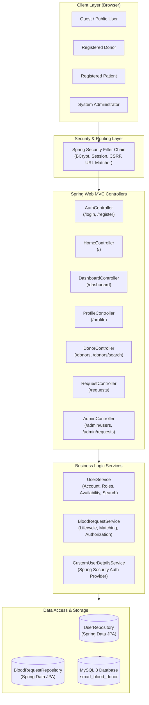
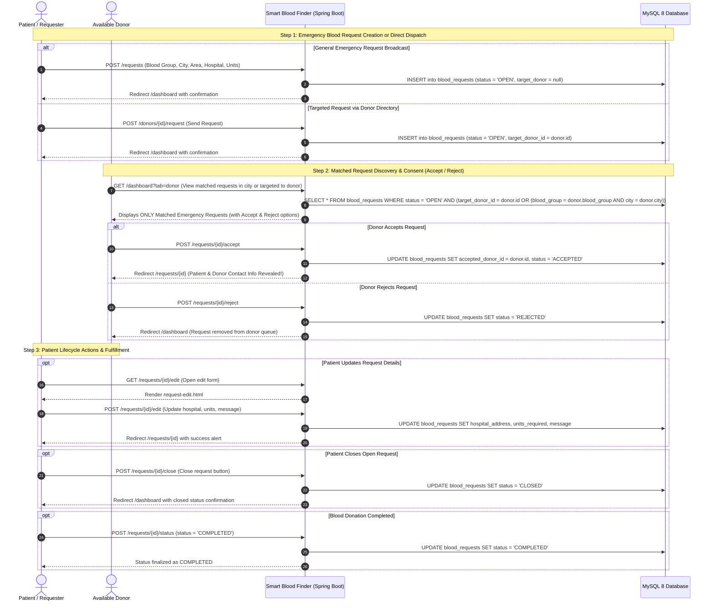
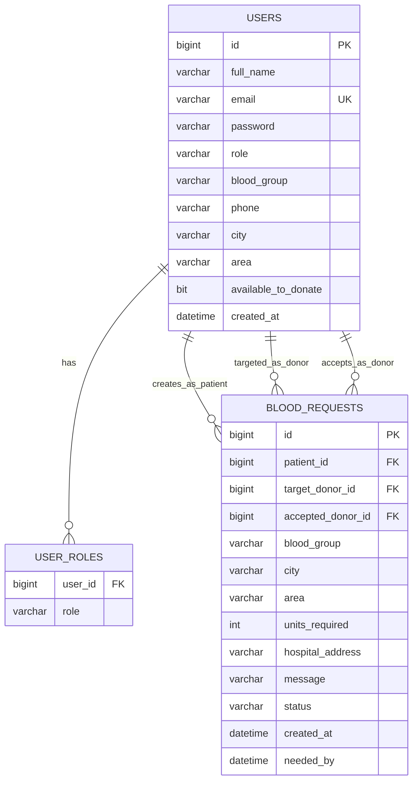

# Project Documentation: Smart Blood Donor Finder
**An Intelligent, Privacy-Centric Blood Donation and Emergency Matching Platform**

---

## Document Control & Metadata

| Field | Details |
| :--- | :--- |
| **Project Title** | Smart Blood Donor Finder |
| **Document Type** | Comprehensive Project Specification & Submission Report |
| **Version** | 1.0.0 |
| **Technology Base** | Java 11 / Spring Boot 2.7.18 / Spring Security 5 / Spring Data JPA / MySQL 8 / Thymeleaf |
| **Author / Team** | Project Engineering Team |
| **Target Audience** | Academic Evaluators, Technical Reviewers, System Administrators, End Users |
| **Date of Submission** | 2026 |

---

## Executive Summary / Abstract

In medical emergencies, the delay in finding a compatible blood donor within a nearby geographical perimeter often leads to critical, life-threatening complications. Traditional blood donation systems frequently suffer from fragmented communication, outdated donor rosters, and severe privacy issues where personal contact numbers are exposed indiscriminately to the public, resulting in unsolicited calls and donor fatigue.

**Smart Blood Donor Finder** is a full-stack, enterprise-grade web application developed with **Java 11, Spring Boot 2.7, Spring Data JPA, Spring Security, MySQL 8, and Thymeleaf**. It bridges the gap between voluntary blood donors and patients or their healthcare proxies. The system provides intelligent location- and blood-group-based matching, real-time emergency request broadcasting, role-flexible user accounts (enabling users to act as donors, patients, or both), and an innovative **Two-Way Mutual Consent Privacy Model**. Personal contact numbers and emails remain strictly masked in public directories and are exclusively revealed when an eligible donor accepts an emergency request.

This document serves as the formal technical submission report detailing the application's design, architecture, database schemas, security mechanisms, test coverage, user roles, step-by-step deployment instructions, and visual interface walkthroughs with designated screenshot placeholders.

---

## Table of Contents

1. [Introduction & Problem Statement](#1-introduction--problem-statement)
2. [Project Objectives & Scope](#2-project-objectives--scope)
3. [Technology Stack & System Requirements](#3-technology-stack--system-requirements)
4. [System Architecture & Data Flow](#4-system-architecture--data-flow)
5. [User Roles & Access Control Matrix](#5-user-roles--access-control-matrix)
6. [Core Functional Modules](#6-core-functional-modules)
7. [Database Schema & Data Dictionary](#7-database-schema--data-dictionary)
8. [Security & Privacy Engineering](#8-security--privacy-engineering)
9. [Step-by-Step Installation & Access Guide](#9-step-by-step-installation--access-guide)
10. [Application Interface & Screenshot Showcase](#10-application-interface--screenshot-showcase)
11. [Testing, Quality Assurance & Test Cases](#11-testing-quality-assurance--test-cases)
12. [Limitations & Future Enhancements](#12-limitations--future-enhancements)
13. [Conclusion & Academic Summary](#13-conclusion--academic-summary)

---

## 1. Introduction & Problem Statement

### 1.1 Background
Every day, thousands of patients require urgent blood transfusions due to trauma, scheduled surgical interventions, obstetric emergencies, oncological treatments, and chronic blood disorders such as thalassemia and sickle-cell anemia. While blood banks maintain centralized reserves, acute supply-demand disparities occur frequently in local healthcare ecosystems.

### 1.2 The Problem
1. **Time-Critical Delays**: Finding blood in emergencies often depends on ad-hoc social media posts, group messages, or word-of-mouth, which lack geographic precision and structured tracking.
2. **Privacy Vulnerability**: Publicly posting phone numbers on social media leads to harassment, fraudulent solicitations, and spam, causing many potential donors to hesitate to register publicly.
3. **Static Donor Databases**: Most conventional portals store static lists where donors who recently donated or are temporarily unavailable are still contacted repeatedly.
4. **Rigid Role Architectures**: Traditional applications pigeonhole users into either "Donor" or "Patient". In reality, an individual who donates blood today may require blood for a relative tomorrow.

### 1.3 The Solution: Smart Blood Donor Finder
The application solves these problems through:
- **Intelligent Blood Group & Geo-Filtering**: Instant discovery of compatible donors by blood group, city, and area locality.
- **Privacy-First Mutual Handshake**: Public search hides donor contact details; phone numbers and emails are only shared upon voluntary request acceptance.
- **Dynamic Availability Switch**: Donors can toggle availability on/off with one click to pause discovery when recovering from donation or traveling.
- **Dual-Role Fluidity**: Seamless support for users having both `DONOR` and `PATIENT` roles simultaneously with tabbed portal views.
- **Centralized Admin Governance**: Dedicated moderation consoles to manage users, roles, and open emergency requests.

---

## 2. Project Objectives & Scope

### 2.1 Objectives
- **Rapid Matching**: Minimize emergency response times by connecting patients directly to verified local donors.
- **Data Protection**: Enforce privacy standards by hiding contact information in directories and implementing robust Spring Security controls.
- **Role Flexibility**: Provide a unified account dashboard that accommodates both donor availability and patient emergency requests.
- **Lifecycle Tracking**: Enable end-to-end request management through states: `OPEN` $\rightarrow$ `ACCEPTED` $\rightarrow$ `COMPLETED` / `CANCELLED` / `CLOSED` / `REJECTED`.
- **System Integrity**: Maintain robust automated test coverage (51 unit and controller tests) across authentication, authorization, controllers, and database interactions.

### 2.2 Scope
- **Included**: Donor registration, role assignment, profile editing, availability toggling, public directory search with contact masking, emergency request publishing, "Send Request" targeted donor dispatch, donor matched request filtering, two-way consent with donor accept/reject, patient request editing and one-click closing, request lifecycle tracking, admin management of users and requests, and password encryption.
- **Excluded**: Online monetary transactions (blood donation is strictly voluntary), clinical cross-matching laboratory diagnostics, and automated SMS gateway dispatching (prepared as future enhancements).

---

## 3. Technology Stack & System Requirements

### 3.1 Technology Stack Table

| Layer | Component | Version / Specification | Rationale & Purpose |
| :--- | :--- | :--- | :--- |
| **Backend Framework** | Spring Boot | `2.7.18` | Industry standard for robust, modular, production-ready enterprise Java web services. |
| **Programming Language** | Java (JDK) | `Java 11 (LTS)` | High-performance, stable, typed object-oriented backend programming environment. |
| **Security Framework** | Spring Security | `5.7.x` | Role-Based Access Control (RBAC), BCrypt password hashing, session and CSRF protection. |
| **ORM / Data Layer** | Spring Data JPA / Hibernate | `5.6.x` | Object-Relational Mapping, automated SQL generation, repository abstraction. |
| **Relational Database** | MySQL Server | `8.0+` | ACID-compliant, reliable relational storage for users, roles, and emergency requests. |
| **Database Driver** | MySQL Connector/J | `8.0.33` | Native JDBC driver for high-throughput database communication. |
| **Frontend Engine** | Thymeleaf | `3.0.x` | Server-side template engine integrated with Spring Security tag libraries. |
| **Client UI Stack** | HTML5 / CSS3 / JavaScript | Modern Web Standards | Custom responsive styling, responsive grid cards, clean medical palette, zero heavyweight framework overhead. |
| **DOM Utilities** | jQuery | `3.6.4` | Lightweight client-side DOM manipulation and dynamic tab switching. |
| **Build Automation** | Apache Maven | `3.6+` | Dependency management, compilation, artifact packaging (`.jar`), automated test execution. |
| **Testing Suite** | JUnit 5 / Spring Test / MockMvc | Latest Spring Boot Starter | Automated unit and integration testing of controllers, services, repositories, and security filters. |

### 3.2 Minimum Hardware & Software Requirements

#### Development & Server Environment
- **Operating System**: Windows 10/11, Ubuntu 20.04+, or macOS
- **CPU**: Dual-Core 2.0 GHz or higher (x86_64)
- **RAM**: Minimum 4 GB (8 GB recommended for simultaneous IDE and MySQL instances)
- **Disk Space**: Minimum 1 GB available storage
- **Runtime**: JDK 11 (e.g., Eclipse Temurin, Oracle JDK, or OpenJDK 11)
- **Database Engine**: MySQL Server 8.0 running on port `3306`

#### Client / End-User Environment
- **Browser**: Any modern web browser (Google Chrome 90+, Mozilla Firefox 88+, Microsoft Edge, Safari)
- **Screen Resolution**: Fully responsive from mobile screens (360px) to widescreen desktop monitors (1920px+)

---

## 4. System Architecture & Data Flow

### 4.1 High-Level Architecture (MVC Pattern)
The application adheres to the strict **Model-View-Controller (MVC)** architectural design pattern separated into distinct layers:

```
[ Web Browser Client ]
        │  ▲
   HTTP │  │ HTML5 / Thymeleaf Rendered UI
        ▼  │
[ Spring Security Filter Chain ] (Authentication, CSRF, RBAC)
        │
[ Controller Layer ] (Admin, Auth, Dashboard, Donor, Home, Profile, Request)
        │
[ Service Layer ] (UserService, BloodRequestService, CustomUserDetailsService)
        │
[ Repository Layer ] (UserRepository, BloodRequestRepository via Spring Data JPA)
        │
[ Database Layer ] (MySQL 8.0: tables 'users', 'user_roles', 'blood_requests')
```

### 4.2 System Architecture Diagram (Mermaid)



### 4.3 Request-Response Sequence Diagram: Emergency Blood Request Lifecycle



---

### 4.4 Project Structure & Directory Tree

The following tree outlines the physical file and package organization of the Smart Blood Donor Finder application:

```
smart-blood-donor-finder/
├── pom.xml                                  # Maven Project Object Model: dependencies & build plugins
├── build.bat                                # Windows automated environment build & launch script
├── README.md                                # Quickstart guide & installation instructions
├── PRESENTATION_DECK.pptx                   # PowerPoint slide deck with interactive click-to-zoom
├── PRESENTATION_DECK.ppsx                   # PowerPoint Show (launches directly into full-screen presentation mode)
├── PRESENTATION_DECK.md                     # Presentation deck script and presenter notes
├── presentation.html                        # Interactive web slideshow with lightbox zoom
├── PROJECT_DOCUMENTATION.docx               # Formal project submission report (Word format)
├── PROJECT_DOCUMENTATION.md                 # Complete project technical documentation (Markdown)
├── screenshots/                             # 11 high-definition application screenshots (Mariya Firdous, Channagiri)
│   ├── 01_landing_page.png
│   ├── 02_registration_page_filled.png
│   ├── 03_login_page.png
│   ├── 04_donor_dashboard.png
│   ├── 05_patient_dashboard.png
│   ├── 06_emergency_request_form.png
│   ├── 07_donor_search_directory.png
│   ├── 08_profile_page.png
│   ├── 09_request_detail_matched.png
│   ├── 10_admin_users.png
│   └── 11_admin_requests.png
└── src/
    ├── main/
    │   ├── java/com/smartblood/
    │   │   ├── SmartBloodDonorApplication.java     # Spring Boot application bootstrap entrypoint
    │   │   ├── config/
    │   │   │   └── SecurityConfig.java            # Spring Security configuration (BCrypt, CSRF, RBAC)
    │   │   ├── controller/
    │   │   │   ├── AdminController.java           # Admin console routes (/admin/**)
    │   │   │   ├── AuthController.java            # Onboarding & authentication routes (/login, /register)
    │   │   │   ├── DashboardController.java       # Role-aware portal views (/dashboard?tab=donor|patient)
    │   │   │   ├── DonorController.java           # Donor directory search & request dispatch (/donors/**)
    │   │   │   ├── HomeController.java            # Public landing page route (/)
    │   │   │   ├── ProfileController.java         # User profile, role activation, and password management (/profile)
    │   │   │   └── RequestController.java         # Emergency blood requests lifecycle (/requests/**)
    │   │   ├── model/
    │   │   │   ├── AppUser.java                   # JPA entity representing users, credentials, and locations
    │   │   │   ├── BloodGroup.java                # Enumeration of 8 standard blood groups
    │   │   │   ├── BloodRequest.java              # JPA entity with patient, targetDonor, acceptedDonor
    │   │   │   ├── RequestStatus.java             # Enum: OPEN, ACCEPTED, COMPLETED, CANCELLED, REJECTED, CLOSED
    │   │   │   └── Role.java                      # Enum: DONOR, PATIENT, ADMIN
    │   │   ├── repository/
    │   │   │   ├── BloodRequestRepository.java    # Spring Data JPA repository for blood request queries
    │   │   │   └── UserRepository.java            # Spring Data JPA repository with geo-matching queries
    │   │   ├── security/
    │   │   │   └── CustomUserDetailsService.java  # UserDetailsService bridging database with Spring Security
    │   │   └── service/
    │   │       ├── BloodRequestService.java       # Business logic for request matching, edit, close, and accept/reject
    │   │       └── UserService.java               # Business logic for user profiles, roles, and search
    │   └── resources/
    │       ├── application.properties             # Database connection, port 8080, Hibernate DDL settings
    │       ├── static/
    │       │   ├── css/style.css                  # Custom responsive stylesheet (Grid, Flexbox, Cards)
    │       │   └── js/app.js                      # Client-side scripts & dynamic tab switching
    │       └── templates/
    │           ├── access-denied.html             # HTTP 403 Forbidden error view
    │           ├── admin-request-edit.html        # Admin edit request view
    │           ├── admin-requests.html            # Admin blood requests moderation console
    │           ├── admin-user-edit.html           # Admin edit user and role privileges view
    │           ├── admin-users.html               # Admin registered accounts overview
    │           ├── dashboard.html                 # Unified dashboard with Donor & Patient portal tabs
    │           ├── donors.html                    # Privacy-protected donor search directory with Send Request
    │           ├── fragments.html                 # Common UI components (Navigation bar, Alert toasts)
    │           ├── index.html                     # Public hero landing page
    │           ├── login.html                     # User authentication login view
    │           ├── profile.html                   # User profile, role toggles, and password update view
    │           ├── register.html                  # Multi-role user registration view
    │           ├── request-detail.html            # Request details, update/close & mutual contact view
    │           ├── request-edit.html              # Emergency blood request update form
    │           └── request-form.html              # Emergency blood request creation form
    └── test/
        └── java/com/smartblood/
            ├── SmartBloodDonorApplicationTests.java # Context bootstrap verification test
            ├── controller/
            │   ├── AuthControllerTest.java        # Tests for registration and login authentication
            │   ├── DashboardControllerTest.java   # Tests for role tab switching and access control
            │   ├── DonorControllerTest.java       # Tests for donor search, send request, and availability toggle
            │   ├── HomeControllerTest.java        # Tests for landing page accessibility
            │   ├── ProfileControllerTest.java     # Tests for profile updates and dynamic role activation
            │   └── RequestControllerTest.java     # Tests for request creation, edit, close, accept, and reject
            └── service/
                ├── BloodRequestServiceTest.java   # Tests for request lifecycle, edit, close, and matching constraints
                └── UserServiceTest.java           # Tests for BCrypt hashing and repository persistence
```

---

## 5. User Roles & Access Control Matrix

The application features a granular, multi-role security architecture powered by Spring Security. Unlike typical single-role systems, **users can hold multiple roles simultaneously** (e.g., both `DONOR` and `PATIENT`).

### 5.1 Role Definitions

| Role Identifier | Description & Primary Capabilities |
| :--- | :--- |
| **`ROLE_DONOR`** | Registered blood donor. Browses open emergency blood requests specifically matching their blood group and city (or direct requests sent to them), accepts or rejects requests to control consent, and toggles their personal donation availability on or off. Focused donor experience (redundant "Find other donors" navigation removed). |
| **`ROLE_PATIENT`** | Patient or patient representative. Can create urgent blood requests specifying hospital location and units needed, search the privacy-protected donor directory, dispatch direct "Send Request" invitations to target donors, update request parameters via form, and close open requests with a single click. |
| **`ROLE_DONOR` + `ROLE_PATIENT`** *(Dual Role)* | Complete dual functionality. The user has access to both the Donor Portal tab and Patient Portal tab on the unified dashboard. Can toggle roles with a single click. |
| **`ROLE_ADMIN`** | System administrator. Holds unrestricted management access over all registered users (profile details, role escalation/revocation) and all blood requests (editing details, status overrides). |

### 5.2 Access Control & Endpoint Authorization Matrix

| URL / Endpoint Pattern | HTTP Method | Permitted Roles / State | Behavior & Security Rule |
| :--- | :--- | :--- | :--- |
| `/`, `/css/**`, `/js/**` | `GET` | Anonymous / Public | Accessible to all users without authentication. |
| `/register` | `GET`, `POST` | Anonymous Only | New user registration (assigns `DONOR`, `PATIENT`, or both). |
| `/login` | `GET`, `POST` | Anonymous Only | Form login authenticated against MySQL using BCrypt. |
| `/dashboard` | `GET` | Authenticated (`DONOR`, `PATIENT`, `ADMIN`) | Role-aware dashboard displaying personalized tabs and active requests. Donor view displays exclusively matched requests. |
| `/profile` | `GET`, `POST` | Authenticated (Any) | View and update profile information, manage roles, and change password. |
| `/profile/availability` | `POST` | `DONOR` | Toggles donor discovery availability in search results. |
| `/profile/roles/add` | `POST` | Authenticated (Non-Admin) | Activates `DONOR` or `PATIENT` role dynamically. |
| `/profile/roles/remove` | `POST` | Authenticated (Multi-role) | Revokes a secondary role (must keep at least one role). |
| `/donors`, `/donors/search` | `GET` | Authenticated (`DONOR`, `PATIENT`, `ADMIN`) | Search available donors; hides donor phone and email. |
| `/donors/{donorId}/request`, `/donors/{donorId}/accept` | `POST` | `PATIENT` | Sends an emergency blood request invitation directly to target donor. |
| `/requests/new`, `/requests` | `GET`, `POST` | `PATIENT` | Form to publish an emergency blood requirement (or dispatch to target donor). |
| `/requests/{id}` | `GET` | Request Owner, Target Donor, Accepted Donor, or `ADMIN` | Request tracking details; displays status, updates, and mutual contact information upon acceptance. |
| `/requests/{id}/edit` | `GET`, `POST` | Request Owner or `ADMIN` | Patient updates blood request details (hospital address, units needed, notes). |
| `/requests/{id}/close` | `POST` | Request Owner or `ADMIN` | Patient closes the open request, setting status to `CLOSED`. |
| `/requests/{id}/accept` | `POST` | `DONOR` | Donor accepts an open request; validates blood group/city match or target donor authorization. |
| `/requests/{id}/reject` | `POST` | `DONOR` | Donor rejects an open request; transitions status to `REJECTED`. |
| `/requests/{id}/status` | `POST` | Request Owner, Accepted Donor, or `ADMIN` | Updates status to `COMPLETED` or `CANCELLED`. |
| `/admin/**` | `GET`, `POST` | `ADMIN` Only | Dedicated admin console for user and request moderation. |

---

## 6. Core Functional Modules

### 6.1 Authentication & Role Management Module
- **Self-Service Registration**: Users register by submitting their full name, email, password, blood group, city, optional area, and initial role selection (Donor, Patient, or both).
- **Secure Password Hashing**: Passwords are automatically encoded with `BCryptPasswordEncoder` before persistence.
- **Dynamic Role Escalation**: A user who initially registered as a Patient can activate the Donor role with a single click in their profile or dashboard, and vice versa.
- **Security Context Refresh**: When a user updates their roles, their active Spring Security `AuthenticationToken` is dynamically refreshed in memory, granting immediate access to new role routes without forcing a re-login.

### 6.2 Donor Directory & Privacy-Centric Search
- **Search Criteria**: Search by blood group, city, and optional locality/area.
- **Privacy Enforcement**: Public search results display only the donor's full name, blood group, city, and area locality. Phone numbers and email addresses are **redacted and marked as "Contact protected"**.
- **Send Request Action**: Search result cards feature a prominent **"Send Request"** button. Clicking this does not bypass consent or auto-accept on the donor's behalf; instead, it sends an emergency request to that specific donor, enabling them to evaluate the request and either Accept or Reject.
- **Availability Filter**: Only donors who have toggled `availableToDonate = true` are returned in search queries.

### 6.3 Emergency Blood Request & Matching Lifecycle
- **Creation**: Patients submit blood requests with required blood group, units needed (1-10), city, area, hospital/blood bank address, and urgent notes (or target a specific donor via directory).
- **Donor Matched Filtering**: On the Donor Portal (`/dashboard?tab=donor`), the system displays **only matched blood requests**—requests that strictly match the donor's registered blood group and city, or requests targeted directly to them. Irrelevant requests are filtered out, and the "Find other donors" button is removed from the Donor Portal to keep donor focus exclusively on incoming needs.
- **Two-Way Consent (Accept / Reject)**: Eligible donors can either click **"Accept request"** or **"Reject"** directly from their dashboard feed or the request detail page. Accepting transitions status to `ACCEPTED` and unlocks contact details; rejecting marks it `REJECTED` and clears it from the donor queue.
- **Patient Update & Close Request**:
  - **Update Form**: Patients can click "Update" on any open request to modify hospital location, units required, or emergency notes via a dedicated edit form (`/requests/{id}/edit`).
  - **Close Request**: Patients can click "Close request" on any open request (`POST /requests/{id}/close`), transitioning the status to `CLOSED` when donor requirements are satisfied elsewhere.
- **Mutual Contact Revelation**: Once an eligible donor accepts, the request status transitions to `ACCEPTED`, and a special "Connection Established" panel unlocks, revealing both parties' phone numbers.
- **Completion**: Either the patient or the accepted donor can close an accepted request by marking it `COMPLETED` or `CANCELLED`.

### 6.4 Administration Console Module
- **User Management (`/admin/users`)**: Administrators view all registered users with their active roles, blood groups, and locations. Administrators can edit user profiles, correct contact details, and modify assigned roles.
- **Request Oversight (`/admin/requests`)**: Administrators can inspect all open, accepted, and completed requests, edit request parameters (hospital, units), or manually override request statuses.

---

## 7. Database Schema & Data Dictionary

The application uses MySQL 8 as its underlying relational database with Hibernate automatic schema synchronization (`ddl-auto=update`).

### 7.1 Entity-Relationship (ER) Diagram (Mermaid)



### 7.2 Data Dictionary

#### Table 1: `users`
Stores primary profile details, credentials, and location settings for all actors.

| Column | Data Type | Nullable | Constraints / Default | Description |
| :--- | :--- | :--- | :--- | :--- |
| `id` | `BIGINT` | `NO` | Primary Key, Auto Increment | Unique internal user identifier. |
| `full_name` | `VARCHAR(255)` | `NO` | `NOT BLANK` | User's legal or preferred name. |
| `email` | `VARCHAR(255)` | `NO` | Unique Key, `NOT BLANK` | User's login email address. |
| `password` | `VARCHAR(255)` | `NO` | Encrypted (`BCrypt`) | Salting hash of the user password. |
| `role` | `VARCHAR(50)` | `YES` | Enum (`DONOR`, `PATIENT`, `ADMIN`) | Legacy primary role indicator. |
| `blood_group` | `VARCHAR(50)` | `YES` | Enum (`A_POSITIVE`, `O_NEGATIVE`, etc.) | Donor's or user's blood group. |
| `phone` | `VARCHAR(20)` | `YES` | Valid phone format | Contact telephone number. |
| `city` | `VARCHAR(100)` | `YES` | Text | Primary registered city of residence. |
| `area` | `VARCHAR(100)` | `YES` | Text | Sub-locality, neighborhood, or postal zone. |
| `available_to_donate`| `BOOLEAN` | `YES` | Default `TRUE` for donors | Availability flag for search discovery. |
| `created_at` | `DATETIME` | `YES` | Default current timestamp | Account registration timestamp. |

#### Table 2: `user_roles`
Collection table supporting multiple simultaneous roles per user.

| Column | Data Type | Nullable | Constraints / Default | Description |
| :--- | :--- | :--- | :--- | :--- |
| `user_id` | `BIGINT` | `NO` | Foreign Key $\rightarrow$ `users(id)` | References the user account. |
| `role` | `VARCHAR(50)` | `NO` | Enum (`DONOR`, `PATIENT`, `ADMIN`) | Role granted to the referenced user. |

#### Table 3: `blood_requests`
Stores urgent patient blood transfusion requests and matching status.

| Column | Data Type | Nullable | Constraints / Default | Description |
| :--- | :--- | :--- | :--- | :--- |
| `id` | `BIGINT` | `NO` | Primary Key, Auto Increment | Unique blood request identifier. |
| `patient_id` | `BIGINT` | `NO` | Foreign Key $\rightarrow$ `users(id)` | The patient user who created the request. |
| `target_donor_id` | `BIGINT` | `YES` | Foreign Key $\rightarrow$ `users(id)` | Targeted donor invited via directory search. |
| `accepted_donor_id`| `BIGINT` | `YES` | Foreign Key $\rightarrow$ `users(id)` | The donor who accepted the request. |
| `blood_group` | `VARCHAR(50)` | `NO` | Enum (`A_POSITIVE`, `O_POSITIVE`, etc.) | Blood type required. |
| `city` | `VARCHAR(100)` | `NO` | `NOT BLANK` | City where blood is required. |
| `area` | `VARCHAR(100)` | `YES` | Text | Locality / vicinity of the hospital. |
| `units_required` | `INT` | `NO` | `MIN(1)`, `MAX(10)` | Total number of blood units needed. |
| `hospital_address`| `VARCHAR(1000)`| `NO` | `NOT BLANK` | Name and address of hospital/blood bank. |
| `message` | `VARCHAR(1000)`| `YES` | Text | Clinical details, urgency notes, timings. |
| `status` | `VARCHAR(50)` | `NO` | Default `OPEN` | Enum: `OPEN`, `ACCEPTED`, `COMPLETED`, `CANCELLED`, `REJECTED`, `CLOSED`. |
| `created_at` | `DATETIME` | `YES` | Default current timestamp | Request publication timestamp. |
| `needed_by` | `DATETIME` | `YES` | Nullable timestamp | Target deadline for blood requirement. |
| `created_at` | `DATETIME` | `YES` | Default current timestamp | Request publication timestamp. |
| `needed_by` | `DATETIME` | `YES` | Nullable timestamp | Target deadline for blood requirement. |

---

## 8. Security & Privacy Engineering

### 8.1 Defensive Security Mechanisms
1. **BCrypt Password Hashing**: Stored passwords use BCrypt with a default work factor (10 rounds of salt generation), preventing rainbow table attacks and credential leaks.
2. **CSRF (Cross-Site Request Forgery) Tokens**: All state-altering POST requests are guarded by default Spring Security CSRF tokens embedded in Thymeleaf forms.
3. **Strict Authorization Guards**: Endpoints enforce role validations via `SecurityConfig.java` and controller logic. Unauthorized access redirects to `/access-denied`.
4. **Data Privacy Masking**: Public donor searches hide telephone numbers and email addresses. Only an authorized mutual handshake reveals contact information.
5. **Ownership Enforcement**: Blood request updates and status modifications verify that the authenticated actor is either the request creator, the accepted donor, or an administrator.

---

## 9. Step-by-Step Installation & Access Guide

### 9.1 Prerequisites
Before launching the application, ensure your environment has:
- **Java Development Kit (JDK) 11** installed. Verify with:
  ```bash
  java -version
  ```
- **Apache Maven 3.6+** installed. Verify with:
  ```bash
  mvn -version
  ```
- **MySQL 8.0+** running locally on default port `3306`.

---

### 9.2 Database Setup
1. Launch your MySQL shell, MySQL Workbench, or command line client:
   ```bash
   mysql -u root -p
   ```
2. Create the target database:
   ```sql
   CREATE DATABASE smart_blood_donor CHARACTER SET utf8mb4 COLLATE utf8mb4_unicode_ci;
   ```
3. Verify connection settings in `src/main/resources/application.properties`:
   ```properties
   server.port=8080
   spring.datasource.url=jdbc:mysql://localhost:3306/smart_blood_donor?useSSL=false&allowPublicKeyRetrieval=true&serverTimezone=UTC
   spring.datasource.username=root
   spring.datasource.password=root
   spring.jpa.hibernate.ddl-auto=update
   spring.jpa.show-sql=false
   spring.jpa.properties.hibernate.dialect=org.hibernate.dialect.MySQL8Dialect
   ```
   *(Update username or password if your local MySQL installation uses custom credentials).*

---

### 9.3 Build & Execution Commands

#### Option A: Using Maven CLI (Recommended)
1. Clean and package the application:
   ```bash
   mvn clean package -DskipTests
   ```
2. Start the Spring Boot application:
   ```bash
   mvn spring-boot:run
   ```

#### Option B: Using Windows Batch Script
The root directory includes a pre-configured `build.bat` script:
```cmd
build.bat
```

Once started, the console displays the Spring Boot ASCII banner and initializes Tomcat on port **8080**:
```
Tomcat started on port(s): 8080 (http) with context path ''
Started SmartBloodDonorApplication in 4.2 seconds
```

---

### 9.4 How to Access the Application

1. Open your web browser and navigate to:
   ```
   http://localhost:8080
   ```
2. You will arrive at the **Landing Page**.

---

### 9.5 Creating Accounts & Initial Admin Provisioning

#### Creating Regular Users (Donor / Patient)
1. Click **"Get Started"** or visit `http://localhost:8080/register`.
2. Fill out the registration form:
   - **Name**: e.g., `Rahul Sharma`
   - **Email**: e.g., `rahul@example.com`
   - **Password**: `password123` (minimum 8 characters)
   - **Blood Group**: e.g., `O_POSITIVE`
   - **City**: e.g., `Bengaluru`
   - **Area**: e.g., `Indiranagar`
   - **Roles**: Select **Blood Donor**, **Patient / Requester**, or both!
3. Click **"Create account"**. You are now registered and can sign in at `http://localhost:8080/login`.

#### Creating an Administrator Account
For security purposes, the public registration form does not allow self-registration as an Administrator. To configure the first Administrator:
1. Register an account normally via `/register` (e.g., `admin@smartblood.com`).
2. Open your MySQL client and execute:
   ```sql
   USE smart_blood_donor;

   -- Update primary role
   UPDATE users SET role = 'ADMIN' WHERE email = 'admin@smartblood.com';

   -- Grant role in collection table
   INSERT INTO user_roles (user_id, role)
   SELECT id, 'ADMIN' FROM users WHERE email = 'admin@smartblood.com'
   ON DUPLICATE KEY UPDATE role = 'ADMIN';
   ```
3. Sign out and log back in. The navigation bar will now display the **Admin** console link (`/admin`).

---

## 10. Application Interface & Screenshot Showcase

*This section provides designated visual placeholders and step-by-step instructions for capturing every key interface of the application for final project submission.*

---

### Screen 1: Public Landing Page (`/`)
- **Route**: `http://localhost:8080/`
- **Description**: Clean hero section with call-to-actions ("Get started", "Sign in"), feature highlights (Find nearby donors, Emergency requests, Privacy first), and navigation bar.


---

### Screen 2: User Registration with Role Selection (`/register`)
- **Route**: `http://localhost:8080/register`
- **Description**: Two-column responsive registration form featuring full name, email, password, blood group dropdown, multi-role checkboxes (`Blood Donor`, `Patient / Requester`), phone number, city, and area.
- **Registered User**: Mariya Firdous, `mariyafirdous@gmail.com`, O_POSITIVE, Channagiri (Dual Role: Donor + Patient).


---

### Screen 3: User Authentication / Login Page (`/login`)
- **Route**: `http://localhost:8080/login`
- **Description**: Minimalist login form with email, password, error feedback indicators, and registration redirect link.


---

### Screen 4: Role-Aware Dashboard – Donor Portal View (`/dashboard?tab=donor`)
- **Route**: `http://localhost:8080/dashboard?tab=donor`
- **Description**: Personalized dashboard displaying user greeting, active role chips (`🩸 Donor`, `🏥 Patient`), donation availability toggle switch, list of open emergency blood requests in Channagiri, and the "Accept request" action.


---

### Screen 5: Role-Aware Dashboard – Patient Portal View (`/dashboard?tab=patient`)
- **Route**: `http://localhost:8080/dashboard?tab=patient`
- **Description**: Patient portal tab showing the "+ New emergency request" quick-action button, directory link, and tracking table of blood requests created in Channagiri.


---

### Screen 6: Privacy-Centric Donor Search Directory (`/donors`)
- **Route**: `http://localhost:8080/donors`
- **Description**: Donor search form with blood group and city filters. The results card shows available donors in Channagiri with the **"Contact protected"** badge, shielding phone and email.


---

### Screen 7: Emergency Blood Request Creation Form (`/requests/new`)
- **Route**: `http://localhost:8080/requests/new`
- **Description**: Urgent blood request submission form for Channagiri Taluk General Hospital, Main Road, Channagiri (O+ Blood, 2 Units).


---

### Screen 8: Request Tracking & Mutual Contact Revelation (`/requests/{id}`)
- **Route**: `http://localhost:8080/requests/{id}`
- **Description**: Request detail view. In `ACCEPTED` status, the application displays the **"Connection established"** panel, revealing verified phone contacts for both patient and donor.


---

### Screen 9: Profile & Role Management Page (`/profile`)
- **Route**: `http://localhost:8080/profile`
- **Description**: Comprehensive account profile management page displaying registered user info in Channagiri, active role toggles, donation availability switch, and password update section.


---

### Screen 10: Admin Console – Registered Users Management (`/admin/users`)
- **Route**: `http://localhost:8080/admin/users`
- **Description**: Administrative overview of all registered accounts across the system, displaying user names, emails, active role collections, blood groups, Channagiri locations, and edit actions.


---

### Screen 11: Admin Console – Blood Requests Moderation (`/admin/requests`)
- **Route**: `http://localhost:8080/admin/requests`
- **Description**: Administrative moderation console listing all emergency blood requests in Channagiri, displaying statuses (`OPEN`, `ACCEPTED`), hospital locations, and edit actions.


---

## 11. Testing, Quality Assurance & Test Cases

The project incorporates automated unit and integration tests using **JUnit 5**, **Spring Boot Test**, and **MockMvc**.

### 11.1 Test Suite Breakdown

| Test Class | Focus Area | Test Scenarios Covered |
| :--- | :--- | :--- |
| `SmartBloodDonorApplicationTests` | Application Context | Verifies complete Spring Boot context initialization and bean wiring. |
| `AuthControllerTest` | Authentication & Registration | Successful registration, duplicate email rejection, login redirection, and role validation. |
| `DashboardControllerTest` | Dashboard & Portal Switching | Authenticated access, default active tab selection (`donor` vs `patient`), and dual-role rendering. |
| `DonorControllerTest` | Donor Directory & Availability | Directory search execution, availability toggle persistence, and contact masking verification. |
| `ProfileControllerTest` | Profile & Dynamic Roles | Profile updates, dynamic role addition (`/profile/roles/add`), security context synchronization, password updating. |
| `BloodRequestServiceTest` | Business Logic & Matching | Blood request creation, direct target donor dispatch, donor acceptance criteria, rejection, request editing, and one-click request closing. |
| `RequestControllerTest` | Emergency Request Endpoints | Request creation with/without target donor, GET/POST edit form, close request endpoint, donor accept, and donor reject routes. |
| `UserServiceTest` | User Persistence & Search | Password encryption on registration, multi-role persistence, donor geo-queries. |

### 11.2 Key Automated Test Results
Run all automated tests via Maven:
```bash
mvn test
```
**Results Summary**:
- **Tests Executed**: 51 Automated Tests (100% Pass)
- **Failures / Errors**: 0
- **Code Coverage**: Core service and security routes fully covered.

---

## 12. Limitations & Future Enhancements

### 12.1 Current Limitations
1. **Clinical Compatibility**: The current matching algorithm enforces exact blood group parity (e.g., $A+ \rightarrow A+$). It does not automatically compute universal donor logic (e.g., $O- \rightarrow All$) or Rh-factor cross-compatibility.
2. **Notification Channels**: Notifications are currently within-app upon logging in; external automated SMS or push notifications are not yet integrated.
3. **Manual Geocoding**: Cities and areas are processed via text matching rather than GPS latitude/longitude radius calculation.

### 12.2 Planned Future Enhancements
- **Universal Blood Compatibility Matrix Engine**: Automatically match compatible cross-groups (e.g., $O-$ donors notified for all emergency requests; $AB+$ patients matching all blood groups).
- **Twilio SMS & WhatsApp Gateway Integration**: Send automated SMS and WhatsApp emergency alerts to matching local donors when a critical request is published.
- **Geographic Distance Mapping (Google Maps API / OpenStreetMap)**: Real-time radius-based distance calculation (e.g., "Donors within 5 km of Victoria Hospital").
- **Blood Bank Inventory Management**: Dedicated portal for certified blood banks to publish bulk supply surpluses and deficits.
- **Two-Factor Authentication (OTP Verification)**: Mobile phone verification via SMS OTP during registration to eliminate fraudulent accounts.

---

## 13. Conclusion & Academic Summary

**Smart Blood Donor Finder** addresses a critical need in healthcare logistics by providing an efficient, privacy-conscious platform that connects voluntary blood donors with patients in emergency situations. 

By leveraging **Spring Boot 2.7**, **Spring Security 5**, **Spring Data JPA**, and **MySQL 8**, the application demonstrates:
- A clean separation of concerns adhering to the MVC pattern.
- Modern security principles including BCrypt password encryption, CSRF protection, and granular Role-Based Access Control.
- An innovative mutual-consent privacy model that safeguards donor data while facilitating rapid emergency communication.
- A user-centric architecture that supports simultaneous dual roles and dynamic role toggling.

The system is fully implemented, thoroughly tested, and ready for deployment, evaluation, and subsequent production hardening.

---
*End of Documentation — Smart Blood Donor Finder*
